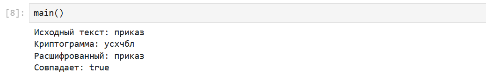

---
## Author
author:
  name: Дурдалыев Максат
  degrees: BSc
  email: 1032268051@rudn.ru
  affiliation:
    - name: Российский университет дружбы народов имени Патриса Лумумбы
      country: Российская Федерация
      postal-code: 117198
      city: Москва
      address: ул. Миклухо-Маклая, д. 6

## Title
title: "Лабораторная работа №3"
subtitle: "Шифрование гаммированием"
license: "CC BY"
---

# Введение

## Цели и задачи

**Цель работы**

Основная цель работы — изучить и реализовать шифрование гаммированием.

**Задание**

С помощью языка программирования Julia реализовать алгоритм шифрования гаммированием конечной гаммой.

## Теоретическое введение

Julia — высокоуровневый свободный язык программирования с динамической типизацией, созданный для математических вычислений[@julialang]. Эффективен также и для написания программ общего назначения. Синтаксис языка схож с синтаксисом других математических языков, однако имеет некоторые существенные отличия.
Для выполнения заданий была использована официальная документация Julia[@juliadoc].

# Выполнение лабораторной работы

**Шифрование гаммированием** — симметричный метод шифрования, при котором к открытым данным(тексту) применяется операция наложения с последовательностью чисел, называемой гаммой.

```julia
alphabet = collect("абвгдежзийклмнопрстуфхцчшщьыъэюя ")
MOD = 33

function char_to_num(c)
    return findfirst(==(c), alphabet)
end

function num_to_char(n)
    if n == 0
        n = MOD
    end
    return alphabet[n]
end

function encrypt(text, gamma)
    text_chars  = collect(lowercase(text))
    gamma_chars = collect(lowercase(gamma))

    encrypted = ""

    for i in 1:length(text_chars)
        p = char_to_num(text_chars[i])
        k = char_to_num(gamma_chars[(i - 1) % length(gamma_chars) + 1])
        c = (p + k) % MOD
        encrypted *= num_to_char(c)
    end

    return encrypted
end

function decrypt(cryptogram, gamma)
    crypto_chars = collect(lowercase(cryptogram))
    gamma_chars  = collect(lowercase(gamma))

    decrypted = ""

    for i in 1:length(crypto_chars)
        c = char_to_num(crypto_chars[i])
        k = char_to_num(gamma_chars[(i - 1) % length(gamma_chars) + 1])
        p = mod(c - k, MOD)
        decrypted *= num_to_char(p)
    end

    return decrypted
end

function main()
    text  = "приказ"
    gamma = "гамма"

    cryptogram = encrypt(text, gamma)
    decrypted  = decrypt(cryptogram, gamma)

    println("Исходный текст:   ", text)
    println("Криптограмма:     ", cryptogram)
    println("Расшифрованный:   ", decrypted)
    println("Совпадает:        ", decrypted == text)
end

main()
```

В результате получим следующее(рис. [-@fig:001]):

{#fig:001 width=100%}


# Вывод


С помощью языка программирования Julia был реализован алгоритм шифрования гаммированием конечной гаммой.

# Список литературы{.unnumbered}

::: {#refs}
:::