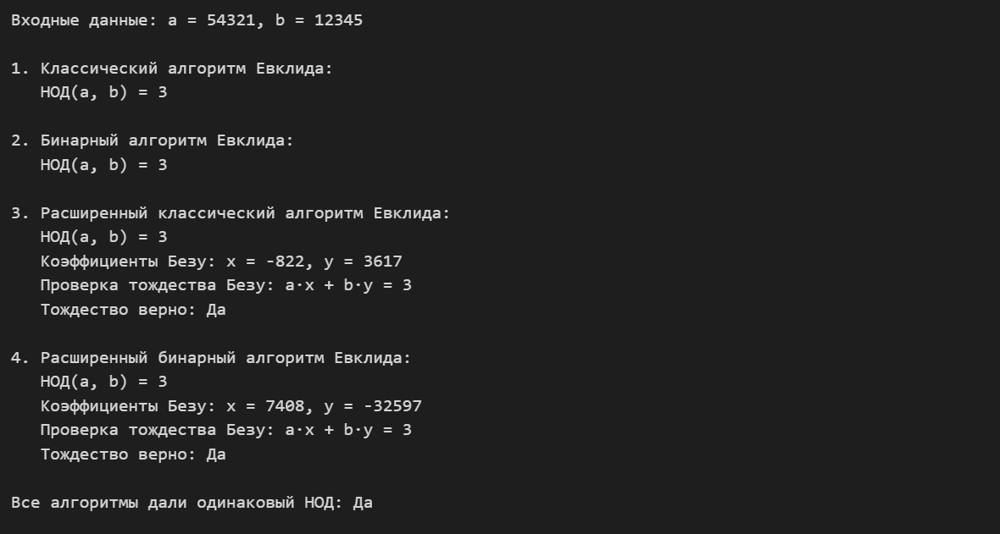

---
## Author
author:
  name: Дурдалыев Максат
  degrees: BSc
  email: 1032268051@rudn.ru
  affiliation:
    - name: Российский университет дружбы народов имени Патриса Лумумбы
      country: Российская Федерация
      postal-code: 117198
      city: Москва
      address: ул. Миклухо-Маклая, д. 6

## Title
title: "Лабораторная работа №4"
subtitle: "Вычисление наибольшего общего делителя"
license: "CC BY"
---

# Введение

## Цели и задачи

**Цель работы**

Основная цель работы — изучить и реализовать алгоритмы вычисления наибольшего общего делителя(НОД) двух целых чисел.

**Задание**

С помощью языка программирования Julia реализовать алгоритмы:

1. Классический алгоритм Евклида;
2. Бинарный алгоритм Евклида;
3. Расширенный классический алгоритм Евклида;
4. Расширенный бинарный алгоритм Евклида.

## Теоретическое введение

**Наибольший общий делитель (НОД)** целых чисел $a_1, a_2, \ldots, a_k$ — это ненулевое целое число $d$, удовлетворяющее двум условиям:

1. Каждое из чисел $a_1, a_2, \ldots, a_k$ делится на $d$;
2. Если $d_1 \neq 0$ — другой общий делитель чисел $a_1, a_2, \ldots, a_k$, то $d$ делится на $d_1$.

Например: $\text{НОД}(12345, 24690) = 12345$, $\text{НОД}(12345, 54321) = 3$, $\text{НОД}(12345, 12541) = 1$.

Для любых целых чисел $a_1, a_2, \ldots, a_k$ существует наибольший общий делитель $d$, и его можно представить в виде **линейной комбинации** этих чисел (тождество Безу):

$$d = c_1 a_1 + c_2 a_2 + \ldots + c_k a_k, \quad c_i \in \mathbb{Z}$$

Например, $\text{НОД}(91, 105, 154) = 7$, и $7 = 7 \cdot 91 + (-6) \cdot 105 + 0 \cdot 154$.

Целые числа $a$ и $b$ называются **взаимно простыми**, если $\text{НОД}(a, b) = 1$.

### Алгоритмы вычисления НОД

**Классический алгоритм Евклида** основан на повторном делении с остатком: $\text{НОД}(a, b) = \text{НОД}(b, a \bmod b)$. Процесс повторяется, пока остаток не станет нулём.

**Бинарный алгоритм Евклида** использует свойства НОД при работе с чётными и нечётными числами, в отличие от классического алгоритма, в нём полностью отсутствует операция взятия остатка от деления, а деление на 2 реализуется как быстрый битовый сдвиг вправо (одна машинная инструкция). Это делает алгоритм особенно эффективным при работе с большими числами в двоичной системе счисления. Основные свойства, на которых он основан:

- Если оба числа чётные: $\text{НОД}(a, b) = 2 \cdot \text{НОД}(a/2, b/2)$;
- Если $a$ нечётное, $b$ чётное: $\text{НОД}(a, b) = \text{НОД}(a, b/2)$;
- Если оба нечётные и $a > b$: $\text{НОД}(a, b) = \text{НОД}(a-b, b)$.

**Расширенный алгоритм Евклида** — модификация классического, которая помимо НОД вычисляет коэффициенты $x$ и $y$ в уравнении Безу: $a \cdot x + b \cdot y = \text{НОД}(a, b)$.

**Расширенный бинарный алгоритм Евклида** сочетает скорость бинарного метода с возможностью нахождения коэффициентов Безу, используя битовые операции и корректировку коэффициентов при делении на 2.

Julia — высокоуровневый свободный язык программирования с динамической типизацией, созданный для математических вычислений[@julialang]. Эффективен также и для написания программ общего назначения. Синтаксис языка схож с синтаксисом других математических языков, однако имеет некоторые существенные отличия.
Для выполнения заданий была использована официальная документация Julia[@juliadoc].

# Выполнение лабораторной работы

## Классический алгоритм Евклида

```julia
function euclidean_gcd(a, b)
    if !(0 < b <= a)
        throw(ArgumentError("Числа не удовлетворяют условию: 0 < b <= a"))
    end
    r0 = a
    r1 = b
    while r1 != 0
        rem = r0 % r1
        r0 = r1
        r1 = rem
    end
    return r0
end
```

## Бинарный алгоритм Евклида
```julia
function binary_gcd(a, b)
    if !(0 < b <= a)
        throw(ArgumentError("Числа не удовлетворяют условию: 0 < b <= a"))
    end
    g = 1
    while a % 2 == 0 && b % 2 == 0
        a = a ÷ 2
        b = b ÷ 2
        g = 2 * g
    end
    u = a
    v = b
    while u != 0
        while u % 2 == 0
            u = u ÷ 2
        end
        while v % 2 == 0
            v = v ÷ 2
        end
        if u >= v
            u = u - v
        else
            v = v - u
        end
    end
    d = g * v
    return d
end 
```

## Расширенный классический алгоритм Евклида

```julia
function extended_euclidean(a, b)
    if !(0 < b <= a)
        throw(ArgumentError("Числа не удовлетворяют условию: 0 < b <= a"))
    end
    r0, r1 = a, b
    x0, x1 = 1, 0
    y0, y1 = 0, 1
    while r1 != 0
        q = r0 ÷ r1
        rem = r0 % r1
        r0 = r1
        r1 = rem
        x0, x1 = x1, x0 - q * x1
        y0, y1 = y1, y0 - q * y1
    end
    return (r0, x0, y0)
end
```

## Расширенный бинарный алгоритм Евклида.

```julia
function extended_binary_gcd(a, b)
    if !(0 < b <= a)
        throw(ArgumentError("Числа не удовлетворяют условию: 0 < b <= a"))
    end
    g = 1
    a_orig = a
    b_orig = b
    while a % 2 == 0 && b % 2 == 0
        a = a ÷ 2
        b = b ÷ 2
        g = 2 * g
    end
    u = a
    v = b
    A = 1; B = 0
    C = 0; D = 1
    while u != 0 
        while u % 2 == 0
            u = u ÷ 2
            if A % 2 == 0 && B % 2 == 0
                A = A ÷ 2
                B = B ÷ 2
            else
                A = (A + b_orig) ÷ 2
                B = (B - a_orig) ÷ 2
            end
        end
        while v % 2 == 0
            v = v ÷ 2
            if C % 2 == 0 && D % 2 == 0
                C = C ÷ 2
                D = D ÷ 2
            else
                C = (C + b_orig) ÷ 2
                D = (D - a_orig) ÷ 2
            end
        end
        if u >= v
            u = u - v
            A = A - C
            B = B - D
        else
            v = v - u
            C = C - A
            D = D - B
        end
    end
    d = g * v
    x = C
    y = D
    return (d, x, y)
end
```

## Тестирование алгоритмов
```julia
a, b = 54321, 12345
println("Входные данные: a = $a, b = $b")
println()

println("1. Классический алгоритм Евклида:")
d1 = euclidean_gcd(a, b)
println("   НОД(a, b) = $d1")
println()

println("2. Бинарный алгоритм Евклида:")
d2 = binary_gcd(a, b)
println("   НОД(a, b) = $d2")
println()

println("3. Расширенный классический алгоритм Евклида:")
d3, x3, y3 = extended_euclidean(a, b)
println("   НОД(a, b) = $d3")
println("   Коэффициенты Безу: x = $x3, y = $y3")
println("   Проверка тождества Безу: a·x + b·y = $(a*x3 + b*y3)")
println("   Тождество верно: $(a*x3 + b*y3 == d3 ? "Да" : "Нет")")
println()

println("4. Расширенный бинарный алгоритм Евклида:")
d4, x4, y4 = extended_binary_gcd(a, b)
println("   НОД(a, b) = $d4")
println("   Коэффициенты Безу: x = $x4, y = $y4")
println("   Проверка тождества Безу: a·x + b·y = $(a*x4 + b*y4)")
println("   Тождество верно: $(a*x4 + b*y4 == d4 ? "Да" : "Нет")")
println()

println("Все алгоритмы дали одинаковый НОД: $(d1 == d2 == d3 == d4 ? "Да" : "Нет")")
```

В результате получим следующий вывод(рис. [-@fig:001]):

{#fig:001 width=100%}


# Вывод


С помощью языка программирования Julia были реализованы алгоритмы вычисления наибольшего общего делителя: классический алгоритм Евклида, бинарный алгоритм Евклида, расширенный классический алгоритм Евклида, расширенный бинарный алгоритм Евклида. Все алгоритмы показали одинаковый результат на тестовых данных, а тождество Безу было успешно проверено для расширенных алгоритмов.

# Список литературы{.unnumbered}

::: {#refs}
:::